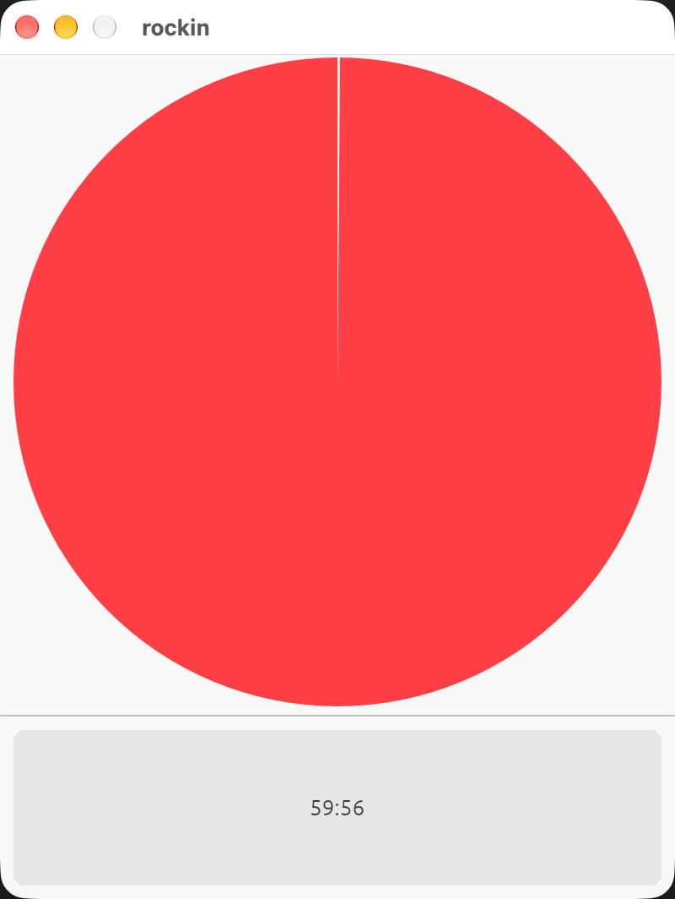
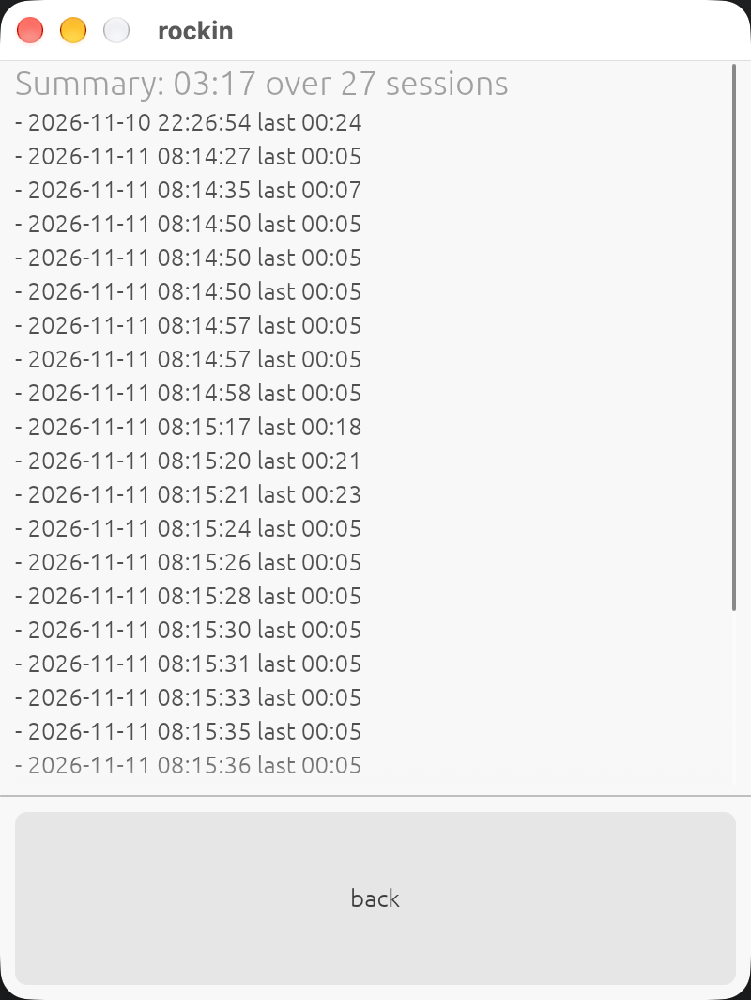

# rock-in

## Screenshot

### Clock mode


### List mode


## Installation
1. **Clone the Repo**
```bash
git clone https://github.com/gorgemul/rock-in.git
cd rock-in
```

2. **Download build dependencies**
```bash
cargo install cargo-packager --locked 
```

3. **build for mac**
```bash
# Without CI=true packager will open the dmg when build the project
CI=true cargo packager --release
```

4. **Run**
```bash
cargo run
```
